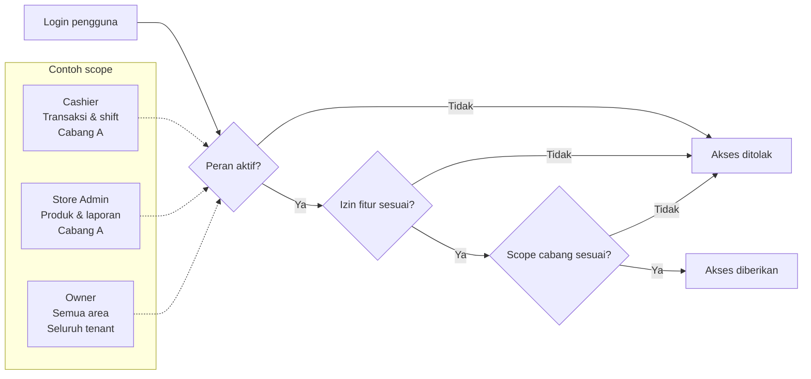

# Matriks Peran Pengguna & Hak Akses (RBAC)

Rumbia POS menggunakan model access control berbasis peran agar setiap orang hanya dapat melihat dan menggunakan fitur yang benar-benar relevan dengan tugasnya.

!!! tip "Inti dari RBAC"
    Setiap pengguna memiliki:

    - akun pengguna
    - satu atau lebih peran
    - hak akses tertentu
    - ruang lingkup cabang yang sesuai

Dengan sistem ini, Anda dapat membatasi akses tanpa menghambat operasional harian.

---

## Prinsip utama

Rumbia POS menerapkan pendekatan berbasis peran dan ruang lingkup:

- **User** → orang yang memakai sistem
- **Role** → tugas atau posisi kerja
- **Permission** → fitur yang bisa diakses
- **Scope** → cabang atau area yang berlaku

Contohnya, kasir di Cabang A tidak otomatis memiliki akses ke data Cabang B.

---

## Peran standar yang tersedia

Rumbia POS menyediakan beberapa peran bawaan yang dibagi ke dalam dua kelompok utama.

### 1. Peran manajerial dan back-office

| Peran | Fokus utama | Cakupan |
| :--- | :--- | :--- |
| Owner | pemilik usaha, legalitas, langganan, rekening, dan keputusan strategis | global/tanpa batas cabang |
| Super Admin | pengelolaan operasional lintas cabang dan konfigurasi sistem | global |
| Store Admin | pengelolaan outlet tertentu | sesuai cabang |
| Store Supervisor | pengawasan transaksi dan operasional harian | sesuai cabang |

### 2. Peran operasional lapangan

| Peran | Fokus utama | Cakupan |
| :--- | :--- | :--- |
| Cashier | transaksi kasir harian | sesuai cabang |
| Server / Waiter | pelayanan pelanggan dan pesanan meja | sesuai cabang |
| Kitchen Staff | proses order di dapur / KDS | sesuai cabang |
| Sales Associate | pendukung layanan pelanggan di area toko | sesuai cabang |
| Stock Staff | stok gudang dan mutasi barang | sesuai cabang |

---

## Ilustrasi akses yang aman

Diagram berikut menunjukkan urutan evaluasi akses: identitas pengguna harus
memiliki peran dan izin yang sesuai, lalu permintaan dibatasi lagi oleh scope
cabang sebelum akses diberikan.

!!! warning "Akses harus paling minimum"
    Berikan hanya hak akses yang dibutuhkan untuk tugas masing-masing orang. Ini membantu menjaga keamanan data dan meminimalkan risiko kesalahan operasional.

---

## Matriks wewenang fitur

| Area fitur | Owner | Super Admin | Store Admin | Store Supervisor | Cashier | Waiter | Kitchen | Sales | Stock |
| :--- | :---: | :---: | :---: | :---: | :---: | :---: | :---: | :---: | :---: |
| Profil legalitas & pajak | Penuh | Terbatas | Lihat | — | — | — | — | — | — |
| Manajemen staf & akses | Penuh | Penuh | Terbatas | — | — | — | — | — | — |
| Katalog master produk | Penuh | Penuh | Terbatas | — | — | — | — | — | — |
| Persetujuan diskon / void / retur | Penuh | Penuh | Penuh | Penuh | — | — | — | — | — |
| Transaksi & pembayaran | Penuh | Penuh | Penuh | Penuh | Penuh | — | — | Terbatas | — |
| Inventaris & mutasi stok | Penuh | Penuh | Penuh | Terbatas | — | — | — | — | Penuh |
| Laporan penjualan | Penuh | Penuh | Penuh | Terbatas | — | — | — | — | — |
| Layar dapur / KDS | Lihat | Lihat | Lihat | Penuh | Lihat | Lihat | Penuh | — | — |

Keterangan:

- **Penuh** = bisa melihat, membuat, mengedit, dan menghapus sesuai kewenangan
- **Terbatas** = hanya untuk area tertentu atau data yang relevan
- **Lihat** = read-only
- **—** = akses ditolak

---

## Prinsip keamanan dan kontrol akses

1. **Least privilege**
   Berikan akses minimum yang dibutuhkan untuk menyelesaikan tugas.

2. **Cabang terisolasi**
   Pengguna dari Cabang A tidak otomatis dapat melihat data Cabang B.

3. **Pemisahan tugas**
   Kasir tidak dapat membatalkan transaksi atau memberikan diskon besar tanpa persetujuan supervisor.

4. **Audit trail**
   Setiap aktivitas penting tercatat berdasarkan akun pengguna aktif.

!!! danger "Larangan penting"
    Jangan membagikan akun atau PIN kasir satu sama lain. Setiap aktivitas operasional dan audit log sistem akan tercatat berdasarkan identitas pengguna yang login.

---

## Prosedur mengundang staf baru

Owner atau admin dapat menambahkan staf baru dari Web Portal dengan langkah berikut:

1. masuk ke menu **Pengaturan**
2. buka **Tim & Hak Akses**
3. klik **Tambah Staf**
4. masukkan nama dan email
5. pilih peran yang sesuai
6. tentukan cabang yang berlaku
7. kirim undangan dan tunggu aktivasi akun

Setelah akun aktif, staf bisa langsung login sesuai hak akses yang diberikan.

---

## Checklist pengaturan akses sebelum operasional

Sebelum tim mulai beroperasi, pastikan hal berikut sudah lengkap:

- [ ] semua akun staf aktif dan email terverifikasi
- [ ] role sudah sesuai dengan pekerjaan harian
- [ ] scope cabang sudah benar
- [ ] supervisor memiliki akses approval yang dibutuhkan
- [ ] kasir hanya dapat masuk ke shift yang menjadi tanggung jawabnya

---

## Langkah selanjutnya

Setelah memahami RBAC, lanjutkan ke setup operasional yang lebih konkret:

- [Panduan cepat: siap transaksi dalam 15 menit](quickstart.md)
- [Pengenalan ekosistem](overview.md)
- [Profil bisnis & pengaturan pajak](../back-office/store-profile-tax.md)
- [Setup hardware printer & scanner](../hardware/printer-scanner.md)

Dengan definisi peran yang jelas, operasional bisnis akan lebih aman, terstruktur, dan mudah diawasi.
